# FinBERT MLOps on AWS SageMaker

**An end-to-end machine learning operations workflow for financial headline sentiment analysis.**


This project automates the full lifecycle of a three-class sentiment model (negative, neutral, positive) for financial news headlines. A SageMaker Pipeline preprocesses the data, fine-tunes a FinBERT model, evaluates it, and registers it in the Model Registry only if it passes an accuracy gate. After a manual approval, the model is deployed to an auto-scaling real-time endpoint, validated, and finally torn down to stop billing.

---

## Table of Contents

1. [Overview](#overview)
2. [Key Features](#key-features)
3. [Architecture](#architecture)
4. [Project Structure](#project-structure)
5. [Prerequisites](#prerequisites)
6. [Installation](#installation)
7. [Quick Start](#quick-start)
8. [Pipeline Details](#pipeline-details)
9. [Deployment and Auto Scaling](#deployment-and-auto-scaling)
10. [Calling the Endpoint](#calling-the-endpoint)
11. [Results](#results)
12. [Cost and Cleanup](#cost-and-cleanup)
13. [Known Limitations](#known-limitations)
14. [Roadmap](#roadmap)
15. [Troubleshooting](#troubleshooting)
16. [Security Notes](#security-notes)
17. [References](#references)

---

## Overview

| Item | Value |
|---|---|
| Task | Three-class sentiment classification of financial headlines |
| Dataset | [`baptle/financial_headlines_market_based`](https://huggingface.co/datasets/baptle/financial_headlines_market_based) |
| Base model | [`baptle/FinBERT_market_based`](https://huggingface.co/baptle/FinBERT_market_based) |
| Orchestration | Amazon SageMaker Pipelines (`FinBERTPipeline`) |
| Model registry group | `FinBERTSentimentClassifiers` |
| Endpoint | `finbert-sentiment-endpoint` on `ml.m5.large` |
| Auto scaling | 1 to 4 instances, target 1,000 invocations per instance per minute |
| Region used | `us-east-1` |

The repository is designed as a **reference implementation**. Training is intentionally small (200 rows, one epoch) so that every stage of the workflow can be exercised quickly and cheaply. See [Known Limitations](#known-limitations) before using any part of it in production.

## Key Features

- **Automated pipeline:** preprocessing, training, evaluation, and conditional registration defined as code in `pipeline.py`.
- **Quality gate:** a `ConditionStep` reads `metrics.accuracy.value` from `evaluation.json` and registers the model only if it meets `ACCURACY_THRESHOLD` (0.60).
- **Human governance:** models are registered as `PendingManualApproval`, so a person must approve a version before deployment.
- **Managed serving:** `ModelBuilder` deploys a real-time endpoint, and Application Auto Scaling keeps capacity between 1 and 4 instances.
- **Built-in verification:** scripted tests return a sentiment label and confidence for each headline, and a latency check measures performance.
- **Clean teardown:** `cleanup.py` removes scaling policies, the endpoint, the registry entries, the pipeline, and optionally the S3 bucket.

## Architecture

The diagram below shows the data science flow from raw data to a monitored, scalable endpoint. Each group of nodes has its own color palette.

```mermaid
flowchart TD

    subgraph SRC["1. DATA SOURCES"]
        HFD["Hugging Face dataset<br/>baptle/financial_headlines_market_based"]
        HFM["Pre-trained base model<br/>baptle/FinBERT_market_based"]
    end

    subgraph PRE["2. PREPROCESSING - SageMaker Processing"]
        P1["PreprocessData step<br/>ScriptProcessor, ml.m5.large"]
        P2["Encode labels<br/>-1, 0, 1 become 0, 1, 2"]
        P3["Split 80 / 10 / 10<br/>seed 42"]
        S3P[("Amazon S3<br/>finbert/processed<br/>train, valid, test")]
    end

    subgraph TRN["3. TRAINING - SageMaker Training"]
        T1["TrainModel step<br/>ModelTrainer, ml.g4dn.xlarge GPU"]
        T2["Fine-tune FinBERT<br/>200 rows, 1 epoch, batch 8"]
        T3[("Amazon S3<br/>model.tar.gz artifact")]
    end

    subgraph EVL["4. EVALUATION - SageMaker Processing"]
        E1["EvaluateModel step<br/>ScriptProcessor, ml.m5.large"]
        E2["Score test split<br/>accuracy with scikit-learn"]
        E3[/"evaluation.json<br/>PropertyFile report"/]
    end

    subgraph GATE["5. QUALITY GATE - ConditionStep"]
        G1{"CheckAccuracy<br/>accuracy at least 0.60 ?"}
        G2["Else branch<br/>pipeline ends, nothing registered"]
    end

    subgraph REG["6. REGISTRY AND GOVERNANCE"]
        R1["CreateModel step<br/>ModelBuilder.build"]
        R2["RegisterModel step<br/>FinBERTSentimentClassifiers v1"]
        R3["Status:<br/>PendingManualApproval"]
        R4["Human review<br/>status set to Approved"]
    end

    subgraph DEP["7. DEPLOYMENT - deploy.py"]
        D1["ModelBuilder.build<br/>HF 4.26.0 inference image"]
        D2(["Real-time endpoint<br/>finbert-sentiment-endpoint<br/>ml.m5.large, InService"])
    end

    subgraph SCL["8. ELASTICITY - Application Auto Scaling"]
        A1["Scalable target<br/>min 1, max 4 instances"]
        A2["Target tracking policy<br/>1000 invocations per instance per min<br/>out 60 s, in 300 s"]
    end

    subgraph VAL["9. VALIDATION AND MONITORING"]
        V1["SageMaker Runtime<br/>invoke_endpoint JSON"]
        V2["test_endpoint.py<br/>label and confidence"]
        V3["Latency check<br/>338 ms single, 120 ms per item batched"]
        V4["Amazon CloudWatch<br/>metrics and logs"]
    end

    subgraph CLN["10. TEARDOWN - cleanup.py"]
        C1["Delete scaling policy, endpoint,<br/>config, model, package, pipeline"]
        C2[("Delete S3 bucket<br/>optional")]
    end

    HFD --> P1
    P1 --> P2 --> P3 --> S3P
    S3P -->|"train channel"| T1
    HFM -->|"base weights"| T2
    T1 --> T2 --> T3
    T3 --> E1
    S3P -->|"test split"| E1
    E1 --> E2 --> E3
    E3 -->|"JsonGet metrics.accuracy.value"| G1
    G1 -->|"false"| G2
    G1 -->|"true"| R1
    G1 -->|"true"| R2
    T3 --> R1
    R2 --> R3 --> R4
    R4 -->|"approved model artifact"| D1
    T3 -.->|"model S3 URI"| D1
    D1 --> D2
    D2 --> A1 --> A2
    D2 --> V1 --> V2
    V2 --> V3
    D2 -.->|"invocation metrics"| V4
    A2 -.->|"scales on traffic"| D2
    D2 ==>|"after exercise"| C1
    C1 --> C2

    classDef src fill:#FFE082,stroke:#FF8F00,stroke-width:2px,color:#4E342E
    classDef pre fill:#90CAF9,stroke:#1565C0,stroke-width:2px,color:#0D2A4A
    classDef trn fill:#CE93D8,stroke:#6A1B9A,stroke-width:2px,color:#2E0B3A
    classDef evl fill:#A5D6A7,stroke:#2E7D32,stroke-width:2px,color:#0F3A14
    classDef gate fill:#EF9A9A,stroke:#C62828,stroke-width:2px,color:#4A0D0D
    classDef reg fill:#FFCC80,stroke:#E65100,stroke-width:2px,color:#4A2300
    classDef dep fill:#80CBC4,stroke:#00695C,stroke-width:2px,color:#06302B
    classDef scl fill:#F48FB1,stroke:#AD1457,stroke-width:2px,color:#4A0A24
    classDef val fill:#9FA8DA,stroke:#283593,stroke-width:2px,color:#10163D
    classDef cln fill:#B0BEC5,stroke:#37474F,stroke-width:2px,color:#10191D

    class HFD,HFM src
    class P1,P2,P3,S3P pre
    class T1,T2,T3 trn
    class E1,E2,E3 evl
    class G1,G2 gate
    class R1,R2,R3,R4 reg
    class D1,D2 dep
    class A1,A2 scl
    class V1,V2,V3,V4 val
    class C1,C2 cln

    style SRC fill:#FFF8E1,stroke:#FF8F00,stroke-width:3px,color:#E65100
    style PRE fill:#E3F2FD,stroke:#1565C0,stroke-width:3px,color:#0D47A1
    style TRN fill:#F3E5F5,stroke:#6A1B9A,stroke-width:3px,color:#4A148C
    style EVL fill:#E8F5E9,stroke:#2E7D32,stroke-width:3px,color:#1B5E20
    style GATE fill:#FFEBEE,stroke:#C62828,stroke-width:3px,color:#B71C1C
    style REG fill:#FFF3E0,stroke:#E65100,stroke-width:3px,color:#BF360C
    style DEP fill:#E0F2F1,stroke:#00695C,stroke-width:3px,color:#004D40
    style SCL fill:#FCE4EC,stroke:#AD1457,stroke-width:3px,color:#880E4F
    style VAL fill:#E8EAF6,stroke:#283593,stroke-width:3px,color:#1A237E
    style CLN fill:#ECEFF1,stroke:#37474F,stroke-width:3px,color:#263238
```



### Design principles

| Principle | How it is applied |
|---|---|
| Automation | Every stage is a named pipeline step, so one command reproduces the workflow. |
| Gating | A numeric threshold controls whether a model is registered. |
| Separation of duties | The pipeline proves a metric was met, and a person approves release. |
| Traceability | Artifacts live in S3, versions in the Model Registry, and runs in Studio. |
| Cost hygiene | Jobs run on short-lived instances, and `cleanup.py` removes everything. |

### Compute and containers

| Stage | Instance | Container |
|---|---|---|
| PreprocessData | `ml.m5.large` | scikit-learn 1.2-1 image, `datasets` installed at start |
| TrainModel | `ml.g4dn.xlarge` | Hugging Face 4.26.0, PyTorch 1.13.1, Python 3.9 (training) |
| EvaluateModel | `ml.m5.large` | Hugging Face 4.26.0 inference image |
| Endpoint | `ml.m5.large`, 1 to 4 instances | Hugging Face 4.26.0 inference image (CPU) |

## Project Structure

```text
./
├── pipeline.py          # Defines and runs FinBERTPipeline (steps 1 to 5 of the workflow)
├── preprocess.py        # Downloads data, encodes labels, writes train/valid/test splits
├── train.py             # Fine-tunes FinBERT with the Hugging Face Trainer
├── evaluate.py          # Computes test accuracy, writes evaluation.json
├── deploy.py            # Deploys the endpoint, configures auto scaling, verifies predictions
├── test_endpoint.py     # 15-headline functional test (positive, negative, neutral, nuanced)
├── test_endpoint1.py    # 3-headline smoke test
├── cleanup.py           # Tears down all billable resources
└── requirements.txt     # Python dependencies
```

## Prerequisites

- An AWS account with access to Amazon SageMaker in the chosen region (`us-east-1` was used).
- A **SageMaker execution role** with permission to use SageMaker, read and write S3, pull container images, and write CloudWatch logs.
- Service quota for **`ml.g4dn.xlarge`** training instances. New accounts may need to request this increase.
- AWS credentials configured locally (`aws configure`) or a SageMaker Studio / notebook environment.
- Python 3.9 or later.
- Outbound internet access from the processing job, because `preprocess.py` downloads the dataset from the Hugging Face Hub at run time.

## Installation

```bash
git clone <your-repository-url>
cd solution

python -m venv .venv
source .venv/bin/activate          # Windows: .venv\Scripts\activate

pip install -r requirements.txt
pip install boto3 sagemaker
```

> The scripts import from `sagemaker.core`, `sagemaker.mlops`, `sagemaker.train`, and `sagemaker.serve`. Install a SageMaker Python SDK release that provides these modules (the newer SDK generation). `requirements.txt` lists only `transformers>=4.41.0`, so the SDK and `boto3` are installed separately above.

## Quick Start

Run all commands from inside the `solution/` folder, because the pipeline references the scripts by relative path.

### Step 1. Run the pipeline

```bash
python pipeline.py --role arn:aws:iam::<account-id>:role/service-role/<SageMakerExecutionRole>
```

Optional: `--bucket <bucket-name>` (defaults to the SageMaker default bucket). The script upserts the pipeline, starts an execution, and waits for completion. The successful run in the evidence took about 19 minutes.

### Step 2. Approve the model

Open **SageMaker Studio > Models > Model registry > `FinBERTSentimentClassifiers`**, open **Version 1**, and set the status to **Approved**. The model arrives as `PendingManualApproval`.

### Step 3. Deploy and verify

Find the training artifact URI in Studio (the `TrainModel` step, **Files** section), then run:

```bash
python deploy.py \
  --model-s3 "s3://<bucket>/finbert-train/pipelines-<id>-TrainModel-<id>/output/model.tar.gz" \
  --role arn:aws:iam::<account-id>:role/service-role/<SageMakerExecutionRole>
```

This deploys `finbert-sentiment-endpoint`, applies the auto scaling policy, and prints sample predictions. Endpoint creation took about three minutes in the evidence.

### Step 4. Run the functional tests

```bash
python test_endpoint1.py                                   # 3 headlines
python test_endpoint.py --endpoint-name finbert-sentiment-endpoint --region us-east-1   # 15 headlines
```

### Step 5. Clean up

```bash
python cleanup.py \
  --endpoint-name finbert-sentiment-endpoint \
  --package-group FinBERTSentimentClassifiers \
  --pipeline-name FinBERTPipeline \
  --bucket <bucket-name> \
  --delete-bucket
```

Omit `--delete-bucket` to delete only the objects under `--s3-prefix` (default `finbert/`).

## Pipeline Details

| Step | Type | What it does | Observed run time |
|---|---|---|---|
| `PreprocessData` | ProcessingStep | Runs `preprocess.py`, outputs `train`, `valid`, `test` to S3 | 5m 03s |
| `TrainModel` | TrainingStep | Runs `train.py` through a `ModelTrainer` on a GPU instance | 6m 08s |
| `EvaluateModel` | ProcessingStep | Runs `evaluate.py`, writes `evaluation.json` via a `PropertyFile` | 7m 33s |
| `CheckAccuracy` | ConditionStep | Compares `metrics.accuracy.value` with `ACCURACY_THRESHOLD` | 0s |
| `CreateModel` | ModelStep | Builds a deployable model from the training artifact | 1s |
| `RegisterModel` | ModelStep | Registers version 1 as `PendingManualApproval` | 1s |

### Data and labels

`preprocess.py` reads the `Title` (headline) and `Global Sentiment` columns, encodes the labels, and splits the data 80/10/10 with seed 42.

| Original value | Encoded label | Meaning |
|---|---|---|
| -1 | 0 | Negative |
| 0 | 1 | Neutral |
| 1 | 2 | Positive |

The endpoint returns the **numeric** label, so clients must map `0`, `1`, `2` back to text.

### Training configuration

| Setting | Value |
|---|---|
| Base model | `baptle/FinBERT_market_based` |
| Output labels | 3 |
| Training rows | First 200 rows of the train split |
| Epochs | 1 |
| Batch size | 8 |
| Max sequence length | 128 tokens |

### Configuration constants

| Constant | File | Value |
|---|---|---|
| `ACCURACY_THRESHOLD` | `pipeline.py` | `0.6` |
| `MODEL_PACKAGE_GROUP` | `pipeline.py` | `FinBERTSentimentClassifiers` |
| `ENDPOINT_NAME` | `deploy.py` | `finbert-sentiment-endpoint` |

## Deployment and Auto Scaling

`deploy.py` performs three actions in order.

1. **Deploy:** retrieves the Hugging Face 4.26.0 inference image, builds a model with `ModelBuilder`, and deploys one `ml.m5.large` instance.
2. **Scale:** registers the endpoint variant with Application Auto Scaling and attaches a target-tracking policy.
3. **Verify:** sends three sample headlines and prints the label and confidence.

| Auto scaling parameter | Value |
|---|---|
| Resource | `endpoint/finbert-sentiment-endpoint/variant/AllTraffic` |
| Dimension | `sagemaker:variant:DesiredInstanceCount` |
| Capacity | Minimum 1, maximum 4 |
| Metric | `SageMakerVariantInvocationsPerInstance` |
| Target value | 1,000 per instance per minute |
| Scale-out cooldown | 60 seconds |
| Scale-in cooldown | 300 seconds |

## Calling the Endpoint

**Request**

```json
{
  "inputs": [
    "The company reported record profits and strong revenue growth.",
    "The stock plummeted after missing earnings expectations."
  ]
}
```

**Response**

```json
[
  { "label": 2, "score": 0.92 },
  { "label": 0, "score": 0.91 }
]
```

**Python example**

```python
import json
import boto3

runtime = boto3.client("sagemaker-runtime", region_name="us-east-1")
id2label = {0: "negative", 1: "neutral", 2: "positive"}

headlines = ["Trading volume remained steady with no major changes."]
response = runtime.invoke_endpoint(
    EndpointName="finbert-sentiment-endpoint",
    ContentType="application/json",
    Body=json.dumps({"inputs": headlines}),
)
for text, pred in zip(headlines, json.loads(response["Body"].read())):
    label = id2label[int(str(pred["label"]).replace("LABEL_", ""))]
    print(f"{label:8} {pred['score']:.2f}  {text}")
```

## Results

| Metric | Value |
|---|---|
| Test accuracy | **0.6245** (gate threshold 0.60, margin +0.0245) |
| Pipeline executions | 4 (V1 and V2 failed after about 5 minutes, V3 21m 10s and V4 18m 52s succeeded) |
| Endpoint creation | About 3 minutes to `InService` |
| Single-request latency | 338.1 ms average |
| Batch of 15 headlines | 1,807.5 ms total, 120.5 ms per headline, 8.3 headlines per second |
| Invocation errors | None (no 4XX or 5XX in CloudWatch) |

**Functional test (15 headlines).** All four strong positive headlines were classified correctly (confidence 0.77 to 0.92), and three of four strong negative headlines were correct. All four neutral-style headlines, and one layoffs headline, were labelled positive with low confidence (0.38 to 0.69). Across the 12 clear-cut cases, 7 were correct, and the neutral class was never predicted.

> The test set size (815 headlines) is inferred from the accuracy value (509 of 815) and is not printed in the run output.

## Cost and Cleanup

SageMaker endpoints are billed for every hour they run, and GPU training instances cost more than CPU instances. **Always run `cleanup.py` when you finish.** In the evidence run, the script removed the scaling policy, scalable target, endpoint, endpoint configuration, model, model package version, pipeline, and S3 bucket. It reported one warning because the model package group could not be deleted while it still contained a package, so delete the empty group manually from the console if it remains.

## Known Limitations

- **Small training run:** only 200 rows and one epoch are used, and the `valid` split is never consumed.
- **Accuracy-only gate:** per-class precision, recall, and F1 are not exported, so the gate cannot detect a class that fails completely.
- **Low threshold:** 0.60 has no stated baseline, and the class distribution was not analysed.
- **Image mismatch:** the registered package uses the GPU inference image, while `deploy.py` deploys the CPU image.
- **Deployment source:** `deploy.py` takes an S3 artifact path, whereas the activity instructions describe retrieving the model from the registry by ARN.
- **Scaling not load tested:** the policy was configured, but only light manual traffic was sent. A sequential latency of about 338 ms suggests a 1,000 per minute target may be high for a single CPU instance.
- **No redundancy:** minimum capacity is one instance in one region.
- **No alarms:** CloudWatch alarms were not configured.
- **External dependency:** preprocessing downloads data from the Hugging Face Hub at run time.
- **Label semantics:** the dataset name suggests market-based labels, so a neutral-sounding headline may legitimately carry a positive or negative label. Confirm against the dataset card.

## Roadmap

| Priority | Improvement | Benefit |
|---|---|---|
| 1 | Train on the full split for several epochs with validation | Higher accuracy and a usable neutral class |
| 2 | Export macro F1 and per-class metrics, attach `ModelMetrics` to the package | Stronger gate and audit trail |
| 3 | Set the threshold from a baseline and a business requirement | Meaningful quality control |
| 4 | Deploy from the registry package with a matching image | Consistency between approval and serving |
| 5 | Load test and tune the scaling target | Proven elasticity |
| 6 | Add CloudWatch alarms and data capture for drift | Early warning in production |
| 7 | Add a confidence cut-off that routes uncertain items to humans | Safer downstream use |

## Troubleshooting

| Symptom | Likely cause and action |
|---|---|
| Pipeline fails after about 5 minutes | Check the failed step logs in CloudWatch. The preprocessing and evaluation scripts pin `numpy`, `pyarrow`, and `datasets` versions, so dependency conflicts are a common cause. |
| `ResourceLimitExceeded` on training | Request a quota increase for `ml.g4dn.xlarge` training jobs. |
| `AccessDenied` on S3 or ECR | Confirm the execution role can read and write the bucket and pull container images. |
| Endpoint stuck in `Creating` | Allow a few minutes, then check the endpoint logs in CloudWatch. |
| Predictions print as `2.0` | The label arrives as a number. Map it with `{0: "negative", 1: "neutral", 2: "positive"}`. |
| `cleanup.py` warns about the package group | Delete the empty model package group manually in the console. |

## Security Notes

- Scope the execution role to the specific bucket, prefixes, and repositories it needs rather than broad managed policies.
- Screenshots and logs can expose account IDs, role names, and S3 paths. Redact them before sharing publicly.
- For production, add a VPC, private endpoints for S3 and SageMaker, customer-managed encryption keys, and request authentication in front of the endpoint.

## References

- Amazon SageMaker Developer Guide: [Pipeline step types](https://docs.aws.amazon.com/sagemaker/latest/dg/build-and-manage-steps-types.html), [Property files](https://docs.aws.amazon.com/sagemaker/latest/dg/build-and-manage-propertyfile.html), [ModelBuilder](https://docs.aws.amazon.com/sagemaker/latest/dg/how-it-works-modelbuilder-creation.html), [Testing endpoints](https://docs.aws.amazon.com/sagemaker/latest/dg/realtime-endpoints-test-endpoints.html)
- [Application Auto Scaling (boto3)](https://docs.aws.amazon.com/boto3/latest/reference/services/application-autoscaling.html)
- Araci, D. (2019). *FinBERT: Financial Sentiment Analysis with Pre-trained Language Models.* arXiv:1908.10063
- Devlin, J., et al. (2019). *BERT: Pre-training of Deep Bidirectional Transformers for Language Understanding.* NAACL-HLT
- Wolf, T., et al. (2020). *Transformers: State-of-the-Art Natural Language Processing.* EMNLP System Demonstrations

## License

[MIT](LICENSE)
